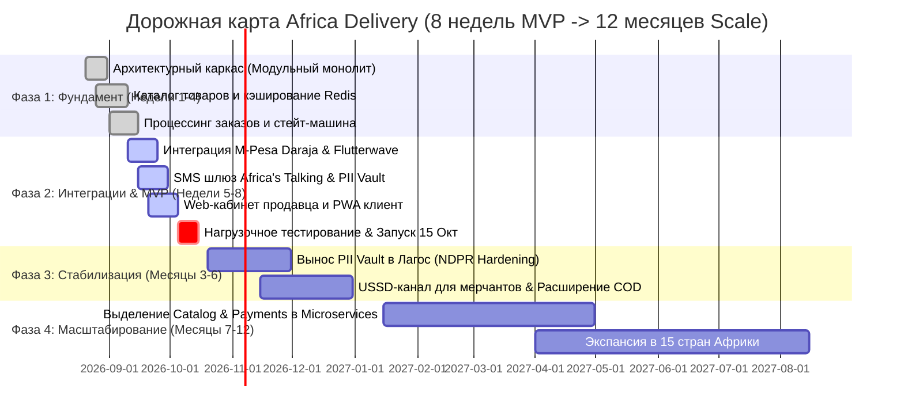

# Дорожная карта запуска и масштабирования (Roadmap 12 месяцев)

---

## 1. Диаграмма Ганта (Gantt Chart)

---

## 2. Детализация четырех контрольных точек (Milestones)

| Контрольная точка | Сроки | Состав функционального скоупа (Scope) | Команда | Стоимость инфраструктуры |
|---|---|---|---|---|
| **M1: Архитектурный каркас (Месяц 1)** | 20 авг — 15 сен | - Каркас Модульного монолита (Go + PostgreSQL Multi-AZ). - Модуль каталога товаров с кэшированием в Redis. - PWA витрина с локализацией на 3 языка (EN, Swahili, Hausa). | 6 контракторов (1 Arch, 3 Back, 1 Front, 1 QA) | **$1 800 / мес** |
| **M2: ЗАПУСК MVP (Месяц 2 / 15 ОКТЯБРЯ)** | 16 сен — 15 окт | - Чекаут и стейт-машина заказов. - Прием оплат M-Pesa + COD (наличные). - SMS-нотификации через Africa's Talking. - Изолированный PII Vault. - **100% готовность к рекламной кампании**. | 6 контракторов + Lead SRE | **$2 000 / мес** *(Запас 60% от лимита CFO)* |
| **M3: Стабилизация и Legal (Месяц 6)** | Ноябрь — Февраль | - Вынос PII Vault на локальный VPS в Лагос (по итогам заключения юристов). - Подключение эквайринга карт Flutterwave в Нигерии и ЮАР. - Добавление USSD-канала для мерчантов с кнопочными телефонами. - Нагрузка до **50 000 заказов/сутки**. | 6 контракторов + 2 инженера поддержки | **$3 800 / мес** |
| **M4: Экспансия и микросервисы (Месяц 12)** | Март — Август | - Выделение `Catalog Service` и `Payment Service` в независимые микросервисы на Kubernetes/EKS. - Запуск в 15 странах Африки. - Масштабирование до **500 000 заказов/сутки** (10M пользователей). | 12 инженеров (2 кросс-функциональные команды) | **$5 600 / мес** |
